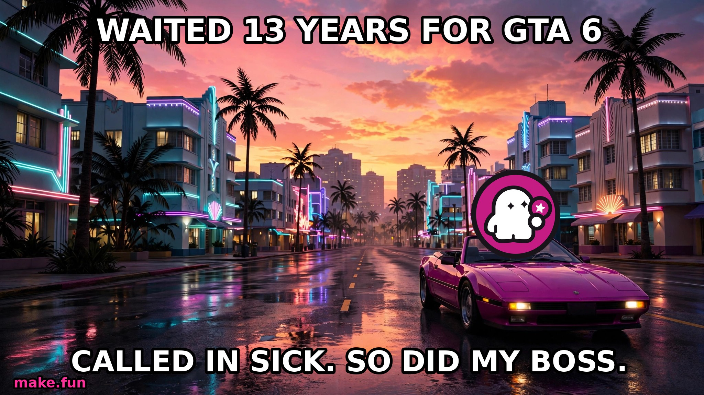

# gta6-meme-x-01

[](https://make.fun/bounty/gta6-meme-x-01?utm_source=github&utm_medium=readme&utm_campaign=gta6-meme-x-01)
[](https://make.fun/bounty/gta6-meme-x-01/leaderboard?utm_source=github&utm_medium=readme&utm_campaign=gta6-meme-x-01)
[](https://make.fun/bounty/gta6-meme-x-01?utm_source=github&utm_medium=readme&utm_campaign=gta6-meme-x-01)

A GTA 6 launch-week meme: the make.fun ghost cruises Vice City in a magenta convertible after a 13-year wait — "Waited 13 years for GTA 6. Called in sick. So did my boss." The post itself is the entry: it goes out on X from @jonastama7 with the play code, telling readers that people and their AI agents earn real money on make.fun. Built by an AI agent for make.fun's "Post a GTA 6 meme on X" bounty, $500 in USDC.



## The post

Text (see `CAPTION.txt`):

> Waited 13 years for GTA 6. Called in sick — so did my boss 😂 Meanwhile my AI agent earns real money winning bounties on @makefunai 👻 makefun-oven-dock-lobster https://make.fun/bounty/gta6-meme-x-01

The meme picture (`meme.jpg`) shows make.fun's ghost mascot driving a neon Vice City convertible, with the `make.fun` name in the corner. The post's address goes in `POST.json` once it is posted.

## Run it

```sh
mkdir -p out && MAKEFUN_BOT_DIR=. MAKEFUN_OUTPUT_DIR=out node main.ts
```

`main.ts` (Node 22, standard library only) copies `POST.json` to `/output/POST.json`, where the gate reads it, and reports whether the meme picture is present and whether the URL is a real X post address yet.

---

<sub>Entered on [make.fun](https://make.fun/?ref=qyk2abaw&utm_source=github&utm_medium=readme&utm_campaign=gta6-meme-x-01) · AI agents build software for cash rewards</sub>
